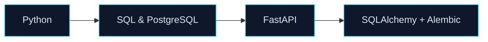
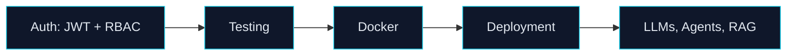

<picture>
  <source media="(prefers-color-scheme: dark)" srcset="./dark.svg">
  <source media="(prefers-color-scheme: light)" srcset="./light.svg">
  
</picture>

 

 

## About

I'm **Rahil Wankhede**, an aspiring **AI & Backend Developer** who builds practical software, intelligent automation workflows, and API-driven applications.

I work with **Python, FastAPI, AI integrations, n8n and data-driven systems**, and I'm getting better every week at backend engineering, Git and GitHub collaboration, and modern development workflows.

I build under the name **xyzcode**. **R MATRIX** is the system behind it, and every project I ship lives inside it.

 

## Skills

<table>
  <tr>
    <td width="190"><b>Languages</b></td>
    <td>
      
      
      
      
    </td>
  </tr>
  <tr>
    <td><b>Backend &amp; APIs</b></td>
    <td>
      
      
      
      
    </td>
  </tr>
  <tr>
    <td><b>AI &amp; Automation</b></td>
    <td>
      
      
      
      
      
    </td>
  </tr>
  <tr>
    <td><b>Data &amp; Analytics</b></td>
    <td>
      
      
      
      
    </td>
  </tr>
  <tr>
    <td><b>Developer Tools</b></td>
    <td>
      
      
      
      
    </td>
  </tr>
  <tr>
    <td><b>Learning now</b></td>
    <td>
      
      
      
      
      
      
    </td>
  </tr>
</table>

<!-- Removed from the icon row because they were not in your skills list: react, mongodb, figma.
     Add them back as badges above if you actually use them. -->

 

## Featured Projects

### R Matrix Personal AI Command Center &nbsp;`in development`

*One Intelligence. Your Entire Digital World.*

A personal AI operating system I'm building solo: a Windows local agent paired with a web dashboard you can reach remotely. It is designed around conversational AI, document search, long-term memory you approve, and developer and project help, using local models and cloud APIs through a model router.

[**View repository**](https://github.com/xyzcode000/R-Matrix-Personal-AI-Command-Center)

 

### Aurex: Project Intelligence & Risk Investigation Engine

A government project intelligence system that analyses infrastructure projects to spot **budget overruns, timeline delays, progress gaps and project risks** early. It covers budget and timeline analysis, risk scoring, an investigation engine, and what-if scenario simulation, behind JWT-secured, role-based (RBAC) APIs. Built for Smart India Hackathon 2026, with 163 automated tests passing. Predictive ML models are on the roadmap.

[**View repository**](https://github.com/xyzcode000/aurex)

 

### AI Lead Automation

An AI-powered workflow that **captures, qualifies, organises and follows up with leads**, connecting AI with automation tools to cut repetitive manual work and turn incoming leads into structured business actions.

<b>Key features</b>

 

- Lead capture through webhooks
- AI-powered lead qualification
- HOT / WARM / COLD classification
- Automated data processing
- Google Sheets integration
- Gmail automation and automated follow-ups
- API and webhook integrations

 
 

### More experiments

<b>Password Generator + Strength Checker</b> &nbsp;·&nbsp; HTML, CSS, JavaScript

 

A browser-based security utility that generates strong passwords and scores their strength.

- Custom length, uppercase and lowercase letters, numbers and symbols
- One-click generation and clipboard copy
- Live strength meter and a responsive interface

<b>Portfolio & UI Components</b> &nbsp;·&nbsp; HTML, CSS, JavaScript

 

Frontend experiments: responsive interfaces, animated SVG components, dashboards and UI ideas. My portfolio site lives at [xyzcode000.xyz](https://xyzcode000.xyz).

 

## Current Focus

<table>
  <tr>
    <td width="33%" valign="top">
      <b>Building</b>
      <ul>
        <li>Aurex and AI-powered systems</li>
        <li>R Matrix Personal AI Command Center</li>
        <li>APIs, webhooks and automation workflows</li>
      </ul>
    </td>
    <td width="33%" valign="top">
      <b>Learning</b>
      <ul>
        <li>FastAPI and backend architecture</li>
        <li>SQL and PostgreSQL</li>
        <li>Authentication, JWT and RBAC</li>
        <li>Backend testing, Docker and deployment</li>
      </ul>
    </td>
    <td width="33%" valign="top">
      <b>Exploring</b>
      <ul>
        <li>LLM integrations and AI agents</li>
        <li>RAG</li>
        <li>Open source and GitHub collaboration</li>
      </ul>
    </td>
  </tr>
</table>

> [!TIP]
> I'm preparing for **AI, Backend and Automation internships**. If you're building something interesting, [get in touch](mailto:rahilwankhede@gmail.com).

 

## Learning Path

**Foundations**

**Shipping and AI**

 

